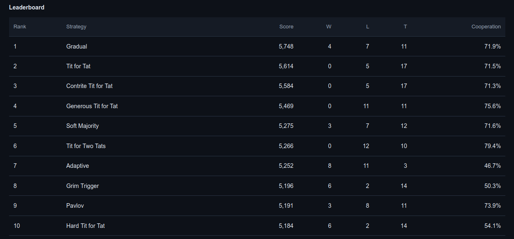
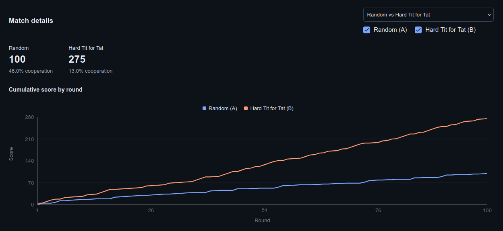

# Game Theory Simulator

Run Iterated Prisoner's Dilemma tournaments between 23 classic strategies and see which ones come out on top.



Pick the strategies you want, set rounds per match and matches per pairing, and run a round-robin tournament. Every match is seeded, so the same settings always produce the same results. Tournaments are saved to PostgreSQL, so you can open old runs and look at any match round by round.



## How it works

- **Backend:** FastAPI and SQLAlchemy, with Alembic migrations. The simulation engine runs about 450K rounds per second, and each tournament is saved in a single transaction, so a failed save never leaves a half-written tournament behind.
- **Frontend:** Next.js and TypeScript.
- **Database:** PostgreSQL.
- **Tests:** 49 pytest tests covering the strategies, scoring, the API, and the database. The 3 PostgreSQL integration tests are skipped unless `TEST_DATABASE_URL` is set.

## Running it locally

```bash
cp .env.example .env    # then set POSTGRES_PASSWORD
docker compose up --build -d
```

Then start the frontend in a second terminal:

```bash
cd frontend
npm ci
cp .env.example .env.local
npm run dev
```

The app runs at http://localhost:3000 and the API docs are at http://localhost:8000/docs.

## API

All routes are under `/api/v1`.

| Method | Route | What it does |
| --- | --- | --- |
| `GET` | `/health` | API and database status |
| `GET` | `/strategies` | List strategies |
| `POST` | `/tournaments` | Run and save a tournament |
| `GET` | `/tournaments` | List saved tournaments |
| `GET` | `/tournaments/{id}` | Get one tournament |
| `GET` | `/matches/{id}` | Get a match's rounds and scores |

```bash
curl -X POST http://localhost:8000/api/v1/tournaments \
  -H 'Content-Type: application/json' \
  -d '{"strategies":["tit_for_tat","always_defect"],"rounds":100,"seed":42}'
```

## Tests

```bash
python -m pip install -e './backend[test]'
python -m pytest backend/tests

cd frontend
npm run lint && npm run typecheck && npm run build
```

## CI/CD

Jenkins runs the whole pipeline (see `Jenkinsfile`):

1. Runs the backend tests and frontend checks inside Docker
2. Builds the API and frontend images, tagged with the commit
3. Pushes both images to Amazon ECR
4. Waits for manual approval
5. Deploys to an AWS EC2 instance over SSH. The deploy script backs up the database to S3, runs migrations, restarts the app, and checks that it's healthy.
